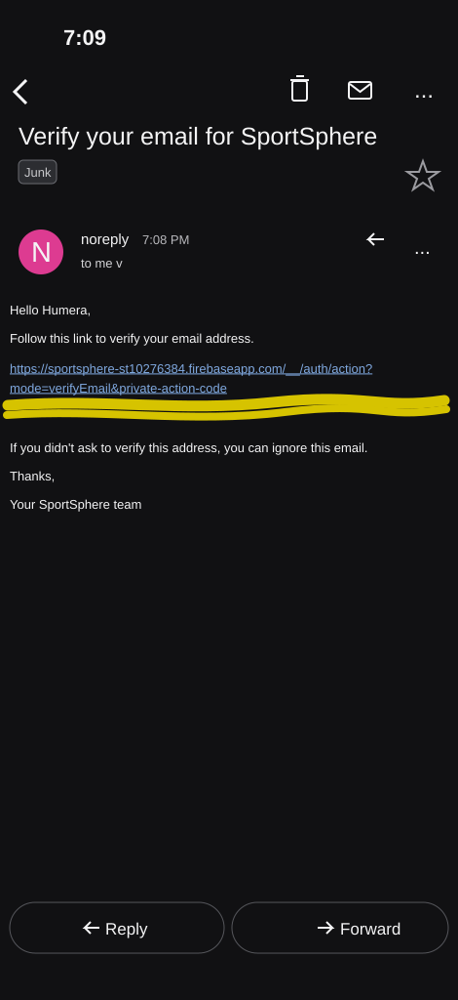

# SportSphere

[](https://github.com/EMWCCN/prog7314-g1-2026-formative-2-part-2-humeramathia/actions/workflows/android.yml)
[](https://github.com/EMWCCN/prog7314-g1-2026-formative-2-part-2-humeramathia/actions/workflows/api.yml)

## Project demonstration

A Part 2 walkthrough of login, Calendar, Performance, and Learn:

**[SportSphere Part 2 demo — YouTube](https://youtu.be/tjFNfCUy-mA)**

That clip does not show the later POE work (biometric unlock, Room offline performance, FCM, or languages). The POE phone video is recorded separately.

## PROG7314 - Group Members

<table>
  <thead>
    <tr>
      <th>Group member</th>
      <th>Student number</th>
      <th>Responsibilities and contribution</th>
    </tr>
  </thead>
  <tbody>
    <tr>
      <td><strong>Humera Mathia</strong><br>Group Leader</td>
      <td><code>ST10276384</code></td>
      <td>
        <ul>
          <li>Designed and implemented the Android user interface.</li>
          <li>Created the Node.js and Express REST API.</li>
          <li>Integrated the REST API with the Android application.</li>
          <li>Wired the screens and Retrofit service to the hosted API.</li>
          <li>Configured and integrated the Azure Cosmos DB database.</li>
          <li>Prepared and maintained the project README documentation.</li>
        </ul>
      </td>
    </tr>
    <tr>
      <td><strong>Mohammed Ba Yazed</strong></td>
      <td><code>ST10174227</code></td>
      <td>
        <p><strong>Authentication Path A — Email and password</strong></p>
        <ul>
          <li>Built registration with display name, email, password, password confirmation, and acceptance of the terms and conditions.</li>
          <li>Added inline validation for empty fields, invalid email addresses, short passwords, and passwords that do not match.</li>
          <li>Created accounts with Firebase <code>createUserWithEmailAndPassword</code>.</li>
          <li>Implemented Firebase email verification without allowing the user to continue directly to Home.</li>
          <li>Built the confirmation screen with <strong>Resend</strong>, <strong>Open email app</strong>, and <strong>I have confirmed</strong> actions.</li>
          <li>Kept unverified users in the confirmation flow until Firebase reports that the address is verified.</li>
          <li>Implemented email/password login and redirected unverified accounts back to confirmation.</li>
          <li>Used Firebase's authenticated session and ID token for API access.</li>
          <li>Added <code>Authorization: Bearer &lt;token&gt;</code> to Retrofit requests through the OkHttp interceptor.</li>
          <li>Handled first-time sport selection and profile updates through <code>PATCH /api/me</code> before entering Home.</li>
        </ul>
        <p><strong>Authentication Path B — Google SSO</strong></p>
        <ul>
          <li>Added the <strong>Continue with Google</strong> login option.</li>
          <li>Connected Android Credential Manager and the Google account picker to Firebase Authentication.</li>
          <li>Skipped the confirmation screen for Google accounts whose email is already verified.</li>
          <li>Used the same Firebase ID-token and Bearer-header flow as email/password authentication.</li>
          <li>Directed users without a saved profile or selected sport to Sport Select; returning users with a sport continue to Home.</li>
          <li>Configured Firebase SHA-1 requirements for emulator and physical-device signing keys.</li>
        </ul>
        <p><strong>User-defined feature — Performance tracking and monthly graph</strong></p>
        <ul>
          <li>Built sport-specific performance forms instead of using a generic score field.</li>
          <li>Loaded metric definitions from <code>GET /api/sports/:sportId</code>; for example, swimming uses distance/time while basketball uses points/rebounds.</li>
          <li>Validated required metric fields and prevented empty submissions.</li>
          <li>Saved sessions through <code>POST /api/performance</code> and persisted them in Cosmos DB.</li>
          <li>Displayed chronological user history from <code>GET /api/performance?sportId=...</code>.</li>
          <li>Built the monthly graph using <code>GET /api/performance/monthly?sportId=&amp;year=&amp;month=&amp;metric=</code>.</li>
        </ul>
      </td>
    </tr>
    <tr>
      <td><strong>Imraan Nordien</strong></td>
      <td><code>ST10434419</code></td>
      <td>
        <p><strong>Calendar and event details</strong></p>
        <ul>
          <li>Built the Calendar bottom-navigation screen.</li>
          <li>Implemented the month view and teal event indicators on dates containing events.</li>
          <li>Added the agenda view with events grouped by date.</li>
          <li>Displayed each event's title, time, type, and venue.</li>
          <li>Supported <code>PRACTICE</code>, <code>SOCIAL_EVENT</code>, and <code>ANNOUNCEMENT</code> type chips.</li>
          <li>Applied the amber selected-state styling used throughout SportSphere.</li>
          <li>Added safe empty-month and failed-load states with a Retry action.</li>
          <li>Built Event Details with title, type, start/end time, venue, description, and notes.</li>
          <li>Added the option to insert an event into the phone's calendar.</li>
          <li>Maintained correct back navigation and bottom-navigation behaviour.</li>
        </ul>
      </td>
    </tr>
    <tr>
      <td><strong>Lilitha Mlobi</strong></td>
      <td><code>ST10454944</code></td>
      <td>
        <p><strong>Learn and resource details</strong></p>
        <ul>
          <li>Built the Learn bottom-navigation screen.</li>
          <li>Implemented Rules, Techniques, Training, and Safety category chips with an amber selected state.</li>
          <li>Filtered learning resources by the user's selected sport and category.</li>
          <li>Displayed resource titles and short body previews.</li>
          <li>Added safe empty-category and failed-load states with a Retry action.</li>
          <li>Built Resource Details with title, category, body, optional image, and optional video link from <code>mediaUrl</code>.</li>
          <li>Maintained correct back navigation and bottom-navigation behaviour.</li>
        </ul>
        <p><strong>Quality assurance</strong></p>
        <ul>
          <li>Configured GitHub Actions workflows.</li>
          <li>Created and maintained unit tests for the project.</li>
        </ul>
      </td>
    </tr>
  </tbody>
</table>

SportSphere is a native Android sports companion for PROG7314. After sign-in the athlete picks one sport, then uses Home, Calendar, Performance, Learn, and Settings for that sport. Performance sessions can be saved on the phone when the API is unreachable. Calendar, Learn, and the monthly graph still need the network.

The Android application uses Firebase Authentication and talks to a custom Node.js REST API. The production API is on Render. Club data lives in Azure Cosmos DB. Learn stills are served from Azure Blob Storage. Performance history is also cached on the phone in Room.

| Project detail | Value |
| --- | --- |
| Android package | `za.co.sportsphere.app` |
| Mobile platform | Native Android (Kotlin) |
| Minimum Android version | API 24 / Android 7.0 |
| Target SDK | 36 |
| Production API | <https://sportsphere-st10276384.onrender.com/> |
| API health check | <https://sportsphere-st10276384.onrender.com/health> |
| Repository | <https://github.com/EMWCCN/prog7314-g1-2026-formative-2-part-2-humeramathia> |

> SportSphere is not an Expo or React Native project. The mobile client in `app/` is a native Kotlin Android application.

## Table of contents

- [Project demonstration](#project-demonstration)
- [PROG7314 - Group Members](#prog7314---group-members)
- [Overview](#overview)
- [Main features](#main-features)
- [Technology stack](#technology-stack)
- [System architecture](#system-architecture)
- [Folder structure](#folder-structure)
- [Prerequisites](#prerequisites)
- [Configuration](#configuration)
- [How to run the project](#how-to-run-the-project)
  - [Run the API locally](#run-the-api-locally)
  - [Run the Android app on an emulator](#run-the-android-app-on-an-emulator)
  - [Run the Android app on a physical device](#run-the-android-app-on-a-physical-device)
- [Physical-device implementation](#physical-device-implementation)
- [Biometric unlock](#biometric-unlock)
- [Firebase authentication and email verification](#firebase-authentication-and-email-verification)
- [REST API](#rest-api)
- [Render hosting](#render-hosting)
- [Azure](#azure)
- [Testing and continuous integration](#testing-and-continuous-integration)
- [Troubleshooting](#troubleshooting)
- [Security notes](#security-notes)
- [Play Store identifier and signed release](#play-store-identifier-and-signed-release)
- [Release notes since Part 2](#release-notes-since-part-2)
- [References](#references)

## Overview

SportSphere is split into two applications:

1. `app/` is the Android client. It contains the screens, Firebase sign-in, Retrofit, Room performance cache, FCM, biometric unlock, and local session preferences.
2. `api/` is the Express REST API. It validates Firebase ID tokens, applies business rules, and reads or writes data in Azure Cosmos DB. Learn stills are URLs into Azure Blob Storage, not files served by Express.

The normal user journey is:

1. Register with an email and password, or sign in with Google.
2. Verify the email address when email/password registration is used.
3. Select one sport from the six-sport catalogue.
4. Optionally turn on fingerprint or face unlock after that first sign-in.
5. Use Home, Calendar, Performance, and Learn. On a later cold start with biometrics on, the lock screen opens before Home loads club data.
6. Open Settings from Home to change name, sport, language, notifications, dark mode, biometrics, or to sign out.

The application uses sport-specific performance fields instead of one generic score. For example, a basketball record can contain points and rebounds, while swimming can use distance and time. The API sends each sport's metric schema to the app; the form also has a local copy of those fields so it can still open if Render is waking up.

The app does not delete Firebase accounts from Settings. Club event titles and Learn bodies stay in the language they were written in; only the app chrome (menus, buttons, status lines) switches with English, Afrikaans, or isiXhosa.

## Main features

### Authentication and account management

- Email/password registration and login through Firebase Authentication
- Google sign-in through Android Credential Manager
- Email verification before an email/password account can enter Home
- Firebase ID tokens attached to protected API requests
- Sign-out clears the Firebase session, Credential Manager state, FCM token, and local biometric flag
- Settings: editable display name, change sport, dark mode, biometric switch, language, notification types, **Sync now**, sign out, and delete account
- Display name, dark mode, language, and notification types are stored on `PATCH /api/me` and applied again on the next login
- A 401 from the API signs the user out. The app pings `/health` on process start so Render can wake

### Sport selection

- Six sports from `GET /api/sports`: Football, Cricket, Tennis, Basketball, Swimming, Athletics
- Each sport defines its own performance metrics
- Sport selection is saved through `PATCH /api/me`. If the API is down the picker shows Retry; there is no local fake catalogue

### Home

- Greeting with the saved display name and a chip for the selected sport
- Next-practice tile from `GET /api/events/next` (needs the network)
- Latest-session tile from the local Room queue (still visible when the API is down)
- Shortcuts into Calendar, Performance, Learn, and Settings

### Calendar

- Month view with a custom day grid and teal markers on dates that have events
- Agenda tab with events grouped by date
- Event types: `PRACTICE`, `SOCIAL_EVENT`, and `ANNOUNCEMENT`
- Create, edit, and delete fixtures you organised; seeded club events (`createdBy: "seed"`) stay read-only
- Event detail: title, type, start/end, venue, description, notes
- Add an event to the phone calendar with Android's insert intent
- Calendar loads from the API. There is no offline event store

### Performance

- Add and delete personal sessions. The add form includes a date picker and sport-specific metric fields
- History reads Room, so a network failure does not wipe saved sessions
- A new session is written to Room first, then WorkManager uploads it. Pending rows show a "Pending sync" badge
- Settings has **Sync performance now** and a last-sync timestamp
- Monthly graph is a custom bar chart with a metric spinner. It still calls `GET /api/performance/monthly` and needs the network

### Learn

- Sport-specific cards, not a shared template with the sport name swapped in
- Categories: `RULES`, `TECHNIQUES`, `TRAINING`, and `SAFETY`
- Techniques and Training stills load from Azure Blob Storage through Glide
- Safety cards open a YouTube link; the app does not play video in-app
- Learn lists and details come from the API. There is no offline guide cache

### Notifications

- Master **Allow notifications** switch, then separate switches for Practice reminders, Social event alerts, and Club announcements
- Android 13+ asks for `POST_NOTIFICATIONS`
- Creating or editing a fixture sends FCM to `sport_<sportId>_<type>`. The phone only subscribes to the types that are switched on
- Tapping a fixture notification opens Calendar
- **Send test notification** calls `POST /api/me/test-notification` (for a wiring check). The marked demo is still a real fixture create
- Sign-out unsubscribes and deletes the FCM token so the previous account cannot keep pushing to this phone

### Languages

- Settings toggle: English, Afrikaans, isiXhosa (not isiZulu)
- The choice is applied immediately with `AppCompatDelegate` and saved on the profile
- Fixture titles and Learn bodies are not translated

### Biometric unlock

- Optional fingerprint, face, or device PIN after a successful Firebase sign-in
- Passwords are never stored on the phone. The switch lives in DataStore and on `biometricEnabled`
- Cold start with the switch on opens `BiometricLockFragment` before Home
- Cancel leaves **Unlock** and **Sign in again**. A phone with no sensor is not locked out of the account

### Look and feel

- Teal/pitch Material theme and a custom adaptive launcher
- Cold start uses Android's SplashScreen API (`Theme.SportSphere.Splash`)
- Dark mode is a Settings switch, stored on the profile, and applied again on login

## Technology stack

| Layer | Technologies |
| --- | --- |
| Android client | Kotlin, AndroidX, Material Components, Navigation Component, ViewBinding, SplashScreen |
| Networking | Retrofit 2.11, OkHttp 4.12, Gson |
| Authentication | Firebase Authentication, Firebase Admin SDK, Google Credential Manager, BiometricPrompt, DataStore |
| Offline performance | Room, WorkManager |
| Push | Firebase Cloud Messaging |
| Images | Glide (Azure Blob HTTPS URLs) |
| API | Node.js 20, Express 4, CORS, dotenv |
| Database | Azure Cosmos DB |
| Media | Azure Blob Storage (`st10276384media/learn`) |
| Production hosting | Render |
| Optional API hosting | Azure App Service |
| Testing | JUnit, Jest, SuperTest |
| CI | GitHub Actions |

## System architecture

```text
Physical Android phone
        |
        | HTTPS + Firebase Bearer token
        v
Render: SportSphere Express API
        |
        | Firebase Admin verifies the token
        |
        +---------------------------> Azure Cosmos DB
        |                               users, sports, events,
        |                               performance, learning
        |
        +---------------------------> Azure Blob Storage (Learn stills)
        |
        +---------------------------> Firebase Cloud Messaging

On the phone, performance history also lives in Room.
WorkManager uploads pending sessions when the network returns.
Calendar, Learn, and the monthly graph do not use that Room store.
```

By default the Android app talks to the hosted Render API, including debug builds on a physical phone. To run the emulator against a local Node process, rebuild with `-Psportsphere.apiBaseUrl=http://10.0.2.2:3000/` (`10.0.2.2` is Android's alias for the host computer).

The app follows a single-activity structure. `MainActivity` hosts Navigation Component fragments and the bottom navigation bar. Retrofit provides typed API calls, while an OkHttp interceptor obtains the current Firebase ID token and adds it to requests.

## Folder structure

Generated directories such as `.gradle/`, `.idea/`, `app/build/`, and `api/node_modules/` are omitted.

```text
Prog7314_Part2/
├── README.md
├── render.yaml                       # Render production service
├── firebase.json
├── .firebaserc                       # Firebase project selection
├── build.gradle.kts                  # Root Android build configuration
├── settings.gradle.kts
├── gradle.properties
├── gradlew / gradlew.bat             # Gradle wrapper
├── gradle/
│   ├── libs.versions.toml
│   └── wrapper/
├── .github/
│   ├── dependabot.yml
│   └── workflows/
│       ├── android.yml               # Android tests and debug build
│       └── api.yml                   # API Jest tests
├── docs/
│   ├── images/email-verification.svg
│   ├── play-store/                   # Listing copy and signing notes (not a live Play listing)
│   ├── PART3-MO.md                   # Offline performance notes
│   └── learn-media/
├── app/                              # Native Android application
│   ├── build.gradle.kts              # SDKs, Play applicationId, API URLs, signing
│   ├── google-services.json          # Firebase clients (committed)
│   ├── proguard-rules.pro
│   └── src/
│       ├── main/
│       │   ├── AndroidManifest.xml
│       │   ├── java/com/example/prog7314_part2/
│       │   │   ├── MainActivity.kt
│       │   │   ├── SportSphereApp.kt
│       │   │   ├── data/             # Room, WorkManager, metrics, Retrofit
│       │   │   ├── notifications/    # FCM registration and messaging service
│       │   │   └── ui/               # auth, home, calendar, performance, learn, settings
│       │   └── res/
│       │       ├── layout/
│       │       ├── navigation/nav_graph.xml
│       │       ├── menu/menu_bottom_nav.xml
│       │       ├── values/ / values-af/ / values-xh/
│       │       └── xml/network_security_config.xml
│       ├── debug/res/xml/            # Debug-only cleartext override for a local API
│       ├── test/                     # Local JUnit tests (FakeRepository is tests-only)
│       └── androidTest/
└── api/                              # Node.js REST API
    ├── package.json
    ├── .env.example
    ├── Procfile
    ├── jest.config.js
    ├── deploy-azure.ps1              # Optional Azure App Service deployment
    ├── src/
    │   ├── server.js
    │   ├── app.js
    │   ├── config.js
    │   ├── firebase.js
    │   ├── seed.js
    │   ├── auth/
    │   ├── middleware/
    │   ├── routes/
    │   ├── pages/
    │   ├── data/
    │   └── store/
    │       ├── index.js
    │       ├── memoryStore.js
    │       └── cosmosStore.js
    └── tests/
```

## Prerequisites

Install the following before running the project:

- Android Studio with Android SDK 36
- JDK 11 or newer; GitHub Actions uses JDK 21
- Node.js 20.x and npm
- Git
- Android Platform Tools/ADB when installing from the command line

For deployment rather than local development:

- A Render account for the production API
- An Azure account and Cosmos DB account
- Azure CLI for the optional App Service deployment script
- A Firebase service-account JSON for server-side token verification

## Configuration

### Android Firebase configuration

`app/google-services.json` is committed so a clone can build. It registers both the Play identifier `za.co.sportsphere.app` and the older debug package `com.example.prog7314_part2`.

```text
Play applicationId: za.co.sportsphere.app
Project ID:         sportsphere-st10276384
```

Kotlin source still uses the `com.example.prog7314_part2` namespace. Play Store rejects `com.example.*`; the Gradle `applicationId` is the identifier that must stay unique.

### API environment

Create the local API environment file in PowerShell:

```powershell
Copy-Item api\.env.example api\.env
```

Important variables include:

| Variable | Purpose |
| --- | --- |
| `PORT` | Express port; defaults to `3000` |
| `HOST` | Bind address; the server defaults to `0.0.0.0` |
| `NODE_ENV` | Development or production environment |
| `SKIP_AUTH` | Local-only authentication bypass |
| `DEV_USER_ID`, `DEV_USER_EMAIL`, `DEV_USER_NAME` | Development identity used by the bypass |
| `COSMOS_ENDPOINT` | Azure Cosmos DB account endpoint |
| `COSMOS_KEY` | Azure Cosmos DB access key |
| `COSMOS_DATABASE` | Cosmos database name; normally `sportsphere` |
| `GOOGLE_APPLICATION_CREDENTIALS` | Local path to a Firebase service-account file |
| `FIREBASE_SERVICE_ACCOUNT` | Inline service-account JSON used by hosted environments |
| `FIREBASE_PROJECT_ID` | Firebase project used to verify tokens |
| `FIREBASE_WEB_API_KEY` | Used by the email-verification page and API fallback |

`API_PUBLIC_URL` appears in `.env.example` for documentation, but the current application does not read it. Android API URLs are generated from `app/build.gradle.kts`.

For an easy local API run, keep:

```dotenv
SKIP_AUTH=true
```

Never enable `SKIP_AUTH` in a public or production deployment.

If a valid `COSMOS_KEY` is not configured locally, the API uses its in-memory store and `/health` reports `"store": "memory"`. This is useful for development, but data disappears when the Node process restarts. Production (`NODE_ENV=production`) refuses to start without Cosmos so a hosted API cannot silently lose data.

## How to run the project

### Run the API locally

From the repository root:

```powershell
Set-Location api
Copy-Item .env.example .env
npm install
npm test
npm start
```

For automatic restarts while editing:

```powershell
npm run dev
```

To seed a configured Cosmos database manually:

```powershell
npm run seed
```

Check that the API started:

```powershell
Invoke-RestMethod http://localhost:3000/health
```

An expected development response resembles:

```json
{
  "ok": true,
  "service": "sportsphere-api",
  "version": "1.0.0",
  "store": "memory",
  "skipAuth": true,
  "firebaseAdmin": false
}
```

`store` changes to `cosmos` when valid Cosmos credentials are available.

### Run the Android app on an emulator

1. Start the local API with `npm start`.
2. Confirm `app/google-services.json` is present (it is committed).
3. Open the repository in Android Studio.
4. Open **Build → Select Build Variant** and choose `debug`.
5. Start an Android emulator.
6. Select the emulator in the device list and click **Run**.

Debug and release both use the hosted Render API by default so a physical phone can sign in without `10.0.2.2`. To point an emulator at a local Node process instead:

```powershell
.\gradlew.bat assembleDebug -Psportsphere.apiBaseUrl=http://10.0.2.2:3000/
```

Do not replace `10.0.2.2` with `localhost` inside an emulator. `localhost` means the emulator itself, while `10.0.2.2` routes to the development computer.

Useful Gradle commands:

```powershell
.\gradlew.bat testDebugUnitTest
.\gradlew.bat assembleDebug
```

The debug APK is produced at:

```text
app/build/outputs/apk/debug/app-debug.apk
```

### Run the Android app on a physical device

The physical-device build uses the hosted Render API, so the phone and development computer do not have to share a local network.

#### Before connecting the device

1. Open <https://sportsphere-st10276384.onrender.com/health> to wake the Render service.
2. Confirm that the response contains `"ok": true`.
3. Confirm `app/google-services.json` is present.
4. On the phone, enable **Developer options** and **USB debugging**.
5. Connect the phone with a data-capable USB cable.
6. Accept the RSA debugging prompt on the phone.

#### Android Studio

1. Open **Build → Select Build Variant**.
2. Select the `debug` or `release` variant for `app`. Both talk to Render, so a physical phone works with either.
3. Choose the physical phone in the device selector.
4. Click **Run**.

#### Command line

From the repository root:

```powershell
# Confirm that the hosted service is available
Invoke-RestMethod https://sportsphere-st10276384.onrender.com/health

# Build the signed coursework release APK
.\gradlew.bat assembleRelease

# Confirm that ADB can see the phone
adb devices

# Install or update SportSphere
adb install -r app\build\outputs\apk\release\app-release.apk
```

On macOS or Linux, use:

```bash
curl https://sportsphere-st10276384.onrender.com/health
./gradlew assembleRelease
adb devices
adb install -r app/build/outputs/apk/release/app-release.apk
```

The APK is created at:

```text
app/build/outputs/apk/release/app-release.apk
```

> Debug and release both use the hosted Render URL, so a physical phone works with either variant. Use `-Psportsphere.apiBaseUrl=http://10.0.2.2:3000/` only when you want an emulator to talk to a local API.

## Physical-device implementation

Running on a phone required more than producing an APK. The app must use a network address the phone can reach, request internet access, use the correct transport security, authenticate hosted requests, and produce an installable signed package.

### 1. Build-specific API addresses

`app/build.gradle.kts` writes `BuildConfig.API_BASE_URL`. Debug and release both default to the hosted Render URL so a physical phone can sign in without `10.0.2.2`. Debug can be pointed at a local Node process with `-Psportsphere.apiBaseUrl=http://10.0.2.2:3000/`.

```kotlin
val debugUrl = providers.gradleProperty("sportsphere.apiBaseUrl")
    .orElse("https://sportsphere-st10276384.onrender.com/").get()
buildConfigField("String", "API_BASE_URL", "\"$debugUrl\"")
```

No URL is typed in the app. Gradle puts the value into `BuildConfig` when it builds the selected variant.

### 2. Retrofit consumes the generated URL

`ApiClient.kt` passes the generated value to Retrofit:

```kotlin
val service: SportSphereApi by lazy {
    Retrofit.Builder()
        .baseUrl(BuildConfig.API_BASE_URL)
        .client(httpClient)
        .addConverterFactory(GsonConverterFactory.create())
        .build()
        .create(SportSphereApi::class.java)
}
```

All interface paths in `SportSphereApi.kt`, such as `api/me` and `api/performance`, are relative to this base URL, so debug and release both talk to Render unless `-Psportsphere.apiBaseUrl` is set.

The OkHttp client uses 60-second connect, read, and write timeouts. A free Render service can take longer than 15 seconds to wake after idle, so the longer window covers the first request after a cold start.

### 3. Android internet permission

`AndroidManifest.xml` grants the application network access:

```xml
<uses-permission android:name="android.permission.INTERNET" />
```

`INTERNET` is a normal Android permission, so the user is not shown a runtime permission dialog.

### 4. Network security

The application links its network policy in `AndroidManifest.xml`:

```xml
<application
    android:networkSecurityConfig="@xml/network_security_config"
    android:usesCleartextTraffic="false"
    ... >
```

Release (`app/src/main/res/xml/network_security_config.xml`) rejects cleartext:

```xml
<network-security-config>
    <base-config cleartextTrafficPermitted="false" />
</network-security-config>
```

Debug overlays that file with `app/src/debug/res/xml/network_security_config.xml` so an emulator can reach `http://10.0.2.2:3000/`. Release traffic uses `https://sportsphere-st10276384.onrender.com/`, so credentials and Firebase tokens are encrypted in transit.

### 5. Firebase token authentication

The production API has `SKIP_AUTH=false`. Every protected request from the phone must therefore include a valid Firebase ID token.

`FirebaseAuthInterceptor.kt` obtains the current token on OkHttp's background thread:

```kotlin
val token = Tasks.await(
    user.getIdToken(false),
    15,
    TimeUnit.SECONDS
).token

val authenticatedRequest = chain.request()
    .newBuilder()
    .header("Authorization", "Bearer $token")
    .build()
```

The resulting request has this form:

```http
Authorization: Bearer <firebase-id-token>
```

The Express `requireAuth` middleware verifies the token with Firebase Admin. It then makes the verified user identity available to routes so records such as performance sessions can be scoped to the correct user.

### 6. The API listens on a hosted interface

The Node server uses the platform's port and binds to all interfaces:

```javascript
const host = process.env.HOST || "0.0.0.0";
app.listen(config.port, host, () => {
  // Server ready
});
```

Binding to `0.0.0.0` is required on hosted platforms. Binding only to `localhost` would make the process unavailable to Render's public routing layer.

### 7. Installable release signing

Release builds do not fall back to the debug keystore. When ignored `keystore.properties` and the private `.jks` are present, Gradle uses the `production` signing config. `preReleaseBuild` fails if those values are missing. The keystore is not in Git. See [Play Store readiness](docs/play-store/README.md).

```kotlin
if (releaseSigningReady) signingConfig = signingConfigs.getByName("production")
```

### 8. Physical-device request path

After installation, a protected request follows this sequence:

```text
Screen/Fragment
  → SportSphereApi Retrofit method
  → FirebaseAuthInterceptor
  → BuildConfig.API_BASE_URL
  → HTTPS request to Render
  → Firebase Admin token verification
  → Route handler
  → Azure Cosmos DB
  → JSON response
  → Retrofit/Gson model
  → Android screen
```

This design removes the phone's dependency on the development computer. Sign-in, Calendar, Learn, and the monthly graph still need Render to be awake. Performance rows already saved in Room stay on the history screen if the API is down.

## Biometric unlock

Biometrics sit on top of Firebase SSO. They do not replace Google or email/password sign-in, and SportSphere never stores a password on the phone (PROG7314 POE tips, s. 3; Android Developers, [s.a.]).

1. The user signs in with Google or a verified email.
2. After that first sign-in, SportSphere asks whether they want fingerprint or face unlock next time.
3. The answer is stored in Jetpack DataStore and also on `PATCH /api/me` as `biometricEnabled`.
4. Settings has an on/off switch. Turning it on must succeed on a `BiometricPrompt` first. The status line under the switch changes immediately so the setting is visibly used.
5. On the next cold start (app killed from Recents), `MainActivity` opens `BiometricLockFragment` **before** Home loads any club data.
6. `BiometricManager.canAuthenticate(BIOMETRIC_STRONG or DEVICE_CREDENTIAL)` is checked first. If the phone has no sensor, nothing enrolled, or is locked out, the user sees a plain-language reason and is not locked out of their account.
7. Cancel on the lock screen leaves **Unlock** (try again / device PIN) and **Sign in again**.

The prompt is hosted on `MainActivity`, which is an `AppCompatActivity`, as required by `BiometricPrompt`.

## Firebase authentication and email verification

### Registration flow

`RegisterFragment.kt` validates the form, creates the Firebase account, updates the display name, sends the verification email, and opens the confirmation screen:

```kotlin
auth.createUserWithEmailAndPassword(email, password)
    .addOnCompleteListener { result ->
        val user = result.result?.user ?: return@addOnCompleteListener
        user.updateProfile(profile)
            .addOnCompleteListener {
                EmailVerification.send(user) { _, message ->
                    findNavController().navigate(
                        R.id.action_register_to_confirm,
                        Bundle().apply { putString("email", email) }
                    )
                }
            }
    }
```

The app does not treat account creation as full access. Login and session checks require `isEmailVerified` for email/password users.

### Creating the verification link

`EmailVerification.kt` sends the user to the hosted success page. The Android package is not wrapped into the Firebase link (that wrapping was breaking the return after verification):

```kotlin
const val CONTINUE_URL =
    "https://sportsphere-st10276384.onrender.com/verified"

val settings = ActionCodeSettings.newBuilder()
    .setUrl(CONTINUE_URL)
    .setHandleCodeInApp(false)
    .build()

user.sendEmailVerification(settings)
```

Firebase sends the user an email similar to the following:

<p align="center">
  
</p>

The screenshot hides the private one-time action code. Verification links should be treated as temporary sensitive links and should not be shared.

### Rate-limit fallback

Repeated verification requests can trigger a Firebase device-level rate limit. SportSphere first calls `FirebaseUser.sendEmailVerification()`. If Firebase reports a rate-limit error, the app calls:

```http
POST /api/auth/send-verification
Authorization: Bearer <firebase-id-token>
```

The API forwards the request to Google Identity Toolkit using the authenticated user's ID token. The confirmation screen also applies a 60-second resend cooldown to prevent accidental repeated requests.

### Confirming verification

The confirmation screen provides three actions:

- **Open email app** launches the device's default mail application.
- **Resend email** sends another link after the cooldown.
- **I have confirmed** refreshes the token, reloads the Firebase user, and checks `isEmailVerified`.

The refresh deliberately forces a new ID token before reloading:

```kotlin
user.getIdToken(true)
    .continueWithTask {
        FirebaseAuth.getInstance().currentUser!!.reload()
    }
```

When verification succeeds, the local session is created and the user is sent to Sport Select or Home.

### Browser page and Android deep links

There are two supported completion paths:

1. The link opens `/verify-email`, whose hosted page applies the Firebase `oobCode`. The user returns to SportSphere and taps **I have confirmed**.
2. Android opens the verification URL directly in SportSphere. `MainActivity` passes the URI to `EmailVerification.applyCodeFrom`, which calls `FirebaseAuth.applyActionCode`.

The manifest registers both the Render verification URL and Firebase's standard action URL:

```xml
<data
    android:scheme="https"
    android:host="sportsphere-st10276384.onrender.com"
    android:pathPrefix="/verify-email" />

<data
    android:scheme="https"
    android:host="sportsphere-st10276384.firebaseapp.com"
    android:pathPrefix="/__/auth/action" />
```

`MainActivity` uses `launchMode="singleTop"` and handles both the first launch and a new intent:

```kotlin
override fun onNewIntent(intent: Intent) {
    super.onNewIntent(intent)
    setIntent(intent)
    handleEmailLink(intent)
}

private fun handleEmailLink(intent: Intent?) {
    EmailVerification.applyCodeFrom(intent?.data) { _, message ->
        Toast.makeText(this, message, Toast.LENGTH_LONG).show()
    }
}
```

## REST API

### Base addresses

| Environment | Base URL |
| --- | --- |
| Local computer | `http://localhost:3000/` |
| Android emulator (optional local API) | `http://10.0.2.2:3000/` via `-Psportsphere.apiBaseUrl` |
| Android app default (debug and release) | `https://sportsphere-st10276384.onrender.com/` |

### Authentication

Except for the health and email-action pages, API routes require:

```http
Authorization: Bearer <Firebase ID token>
```

When `SKIP_AUTH=false`:

- A missing token returns `401`.
- An invalid or expired token returns `401`.
- Missing Firebase Admin configuration returns `503`.

When local `SKIP_AUTH=true`, the middleware uses the configured development identity. This mode must never be exposed publicly.

### Public endpoints

| Method | Endpoint | Purpose |
| --- | --- | --- |
| `GET` | `/health` | Service, store, auth, and Firebase status |
| `GET` | `/verify-email` | Hosted Firebase email-verification page |
| `GET` | `/auth/action` | Alternate route to the same verification page |
| `GET` | `/verified` | Verification-success page |

### Authentication endpoint

| Method | Endpoint | Purpose |
| --- | --- | --- |
| `POST` | `/api/auth/send-verification` | Authenticated fallback for sending a verification email |

### Profile endpoints

| Method | Endpoint | Purpose |
| --- | --- | --- |
| `GET` | `/api/me` | Get or create the signed-in user's profile |
| `PATCH` | `/api/me` | Update display name, selected sport, dark mode, biometric unlock, language, FCM token, or notification type switches |
| `DELETE` | `/api/me` | Delete the Cosmos profile (Firebase Auth deletion happens on the phone) |
| `POST` | `/api/me/test-notification` | Push a test message to this account's registered phone |

### Sport endpoints

| Method | Endpoint | Purpose |
| --- | --- | --- |
| `GET` | `/api/sports` | List the sport catalog and metric schemas |
| `GET` | `/api/sports/:sportId` | Get one sport |

### Event endpoints

| Method | Endpoint | Purpose |
| --- | --- | --- |
| `GET` | `/api/events?sportId=&from=&to=` | List events for a sport and optional period |
| `GET` | `/api/events/next?sportId=` | Get the next event or most recent event |
| `GET` | `/api/events/:eventId` | Get event details |
| `POST` | `/api/events` | Create an event |
| `PUT` | `/api/events/:eventId` | Update an event |
| `DELETE` | `/api/events/:eventId` | Delete an event |

The Android calendar can create fixtures and can edit or delete fixtures the signed-in user organised. Seeded club events (`createdBy: "seed"`) stay read-only. Text fields are length-limited on the API.

### Performance endpoints

| Method | Endpoint | Purpose |
| --- | --- | --- |
| `GET` | `/api/performance?sportId=` | List the current user's sessions |
| `GET` | `/api/performance/:sessionId` | Get one owned session |
| `POST` | `/api/performance` | Add a session |
| `DELETE` | `/api/performance/:sessionId` | Delete an owned session |
| `GET` | `/api/performance/monthly?sportId=&year=&month=&metric=` | Get monthly chart data |

Example performance request:

```json
{
  "sportId": "basketball",
  "recordedAt": 1789228800000,
  "notes": "Home fixture",
  "metrics": {
    "points": 22,
    "rebounds": 8
  }
}
```

Performance data is user-scoped. The API uses the verified Firebase user ID rather than trusting a user ID sent in the request body.

### Learning endpoints

| Method | Endpoint | Purpose |
| --- | --- | --- |
| `GET` | `/api/learn?sportId=&category=` | List learning cards |
| `GET` | `/api/learn/:guideId` | Get one learning item |

## Render hosting

Render is the primary production host used by the Android release build.

The root `render.yaml` Blueprint defines:

```yaml
services:
  - type: web
    name: sportsphere-st10276384
    runtime: node
    plan: free
    region: oregon
    rootDir: api
    buildCommand: npm install
    startCommand: node src/server.js
    healthCheckPath: /health
    autoDeploy: true
```

Render performs the following:

1. Uses `api/` as the service root.
2. Installs npm dependencies.
3. Starts `node src/server.js`.
4. Checks `/health` to determine service health.
5. Automatically deploys repository changes.
6. Injects production environment variables.

The Blueprint fixes `SKIP_AUTH` to `"false"`. `COSMOS_ENDPOINT`, `COSMOS_KEY`, and `FIREBASE_SERVICE_ACCOUNT` are marked `sync: false`, which means their secret values must be entered in the Render dashboard and are not stored in the repository.

Because the service uses the free plan, it may sleep after inactivity. If the first app request fails or takes longer than normal, open the health URL, wait for a successful response, and retry in the app.

## Azure

SportSphere uses Azure in two separate ways.

### Azure Cosmos DB

Cosmos DB is the production data store, even when the API itself runs on Render. `api/src/store/cosmosStore.js` creates the database and containers when necessary.

| Container | Partition key | Stores |
| --- | --- | --- |
| `users` | `/userId` | Profiles, selected sport, dark mode, biometric flag, language, FCM token |
| `sports` | `/sportId` | Sport catalog and metric definitions |
| `events` | `/sportId` | Calendar events |
| `performance` | `/userId` | User performance sessions |
| `learning` | `/sportId` | Learning content |

Partition keys match the most common query boundary. User-owned performance data is partitioned by user, while sport content is partitioned by sport.

At startup, the API checks whether sports exist and seeds the catalog when needed. A configured database can also be seeded explicitly with:

```powershell
Set-Location api
npm run seed
```

`npm run seed` **upserts** learning documents, so re-running it after a media-URL change updates Cosmos even when sports already exist.

### Azure Blob Storage

Learn still images are served from Azure Blob Storage, which is the POE blob-storage outcome (Microsoft, [s.a.]). YouTube links stay on Safety cards.

| Detail | Value |
| --- | --- |
| Storage account | `st10276384media` |
| Container | `learn` (anonymous blob read) |
| Public base URL | `https://st10276384media.blob.core.windows.net/learn/` |
| Example | `https://st10276384media.blob.core.windows.net/learn/football-techniques.jpg` |

Techniques and Training each have a sport-specific JPEG. Create the account and upload the files with:

```powershell
az login
powershell -File api\scripts\provision-learn-blob.ps1
Set-Location api
npm run seed
```

Then open a Techniques card in the app and confirm the image URL in Azure Portal → Storage browser. Glide loads the HTTPS blob; the Safety button still opens YouTube.

### Optional Azure App Service deployment

`api/deploy-azure.ps1` is an alternative deployment path for the Express API. It:

1. Creates resource group `prog7314-rg`.
2. Creates a Linux B1 App Service plan.
3. Creates the `sportsphere-st10276384` web app.
4. Selects the Node 20 LTS runtime.
5. sets `node src/server.js` as the startup command.
6. Reads Cosmos values from `api/.env`.
7. Adds the Firebase service account when the local JSON file exists.
8. Creates a deployment ZIP and uploads it with Azure CLI.

Run it after installing Azure CLI and authenticating:

```powershell
az login
powershell -File api\deploy-azure.ps1
```

Its health URL is:

```text
https://sportsphere-st10276384.azurewebsites.net/health
```

The Android release build currently points to Render, not Azure App Service. Changing hosting providers requires changing the release `API_BASE_URL` and rebuilding the APK.

> Configuration note: `api/deploy-azure.ps1` currently sets `FIREBASE_PROJECT_ID=sportsphere-b3c84`, while the Android app, `.firebaserc`, and Render use `sportsphere-st10276384`. Correct that setting before using Azure App Service for the current Firebase project.

## Testing and continuous integration

### API tests

```powershell
Set-Location api
npm install
npm test
```

Jest and SuperTest test the Express routes. The API GitHub Actions workflow runs tests with local authentication bypassed.

### Android tests and builds

From the repository root:

```powershell
.\gradlew.bat testDebugUnitTest
.\gradlew.bat assembleDebug
```

The Android workflow runs unit tests and creates a debug APK. Unit tests cover metrics, mappers, learning URLs, biometric decisions, languages, push topics, and Room session entities. `FakeRepository` exists only for those tests; the running app does not use it.

## Troubleshooting

### The phone cannot load data

- Open the Render health check and wait for `"ok": true` (the free service sleeps).
- Confirm that the phone has internet access.
- Confirm that Firebase sign-in completed successfully.
- Debug and release both use Render unless you overrode the debug URL.
- Calendar, Learn, and the monthly graph need the network. Performance history can still show Room rows that have not uploaded yet.

### The emulator cannot reach the local API

- Confirm that `npm start` is running in `api/`.
- Use `http://10.0.2.2:3000/`, not `localhost`, from Android.
- Confirm that the `debug` build variant is selected.
- Check whether a firewall is blocking Node.js.

### API returns 401

- Sign out and sign in again to refresh the Firebase session.
- Confirm that the app and API use the same Firebase project.
- Confirm that `FirebaseAuthInterceptor` is attaching the token.
- For local development only, confirm whether `SKIP_AUTH=true` is intended.

### API returns 503 for authentication

Firebase Admin is not configured on the server. Add either:

- `GOOGLE_APPLICATION_CREDENTIALS` pointing to a local service-account file, or
- `FIREBASE_SERVICE_ACCOUNT` containing the service-account JSON in the hosted environment.

### Verification email is missing

- Check Spam or Junk.
- Wait 60 seconds before resending.
- Open the link in Chrome if an in-app mail browser does not complete the action.
- Return to SportSphere and tap **I have confirmed**.

### `adb devices` shows `unauthorized`

Unlock the phone, accept the RSA prompt, and run `adb devices` again. If no prompt appears, revoke USB debugging authorizations in Developer options and reconnect the cable.

## Security notes

Never commit:

```text
api/.env
api/firebase-service-account.json
Cosmos DB keys
Private Android release keystores
```

Additional safeguards:

- Keep `SKIP_AUTH=false` in every hosted environment.
- Rotate a Cosmos key immediately if it is exposed.
- Store Render and Azure secrets in their platform settings.
- Use HTTPS for every production API request.
- Do not commit `keystore.properties` or the `.jks`. There is no debug-keystore fallback on release.
- Do not publish verification links because they contain one-time action codes.

## Play Store identifier and signed release

The installed package is `za.co.sportsphere.app`. Kotlin source still uses the `com.example.prog7314_part2` namespace; Play Store looks at `applicationId`, not the Kotlin package.

Release builds enable R8 minify and resource shrinking. Signing reads ignored `keystore.properties` and a private `.jks` that is not in Git. That is a signed local build, not a listing on Google Play. Store screenshots, the 512 PNG, the feature graphic, and a privacy-policy URL are still listed in [Play Store readiness](docs/play-store/README.md) as evidence to prepare, not as files already in this folder.

There is no `v1.0.0-final-poe` tag or GitHub Release until `merge` is on `main`. Do not treat this README as claiming those exist.

## Release notes since Part 2

**New**
- Fingerprint / face / device-PIN unlock on cold start, with a Settings switch
- Room + WorkManager offline performance saves, pending badge, sync now, last-sync time
- FCM fixture pushes by type (practice, social event, announcement) and a Settings test send
- English, Afrikaans, and isiXhosa UI, including errors, biometrics, and notifications
- Azure Blob stills on Techniques and Training Learn cards
- Delete account in Settings
- Signed Play identifier `za.co.sportsphere.app`, splash, and custom launcher

**Improved**
- Settings round-trip for display name, dark mode, language, and notification types
- Calendar create / edit / delete for fixtures the user organised
- Performance date picker, metric spinner, and Home latest-session tile
- 60 s API timeouts and a `/health` ping on app start
- Friendly login errors (`Incorrect password, please try again`) instead of Firebase codes
- Notification tap opens Calendar

**Fixed**
- Part 2 SSO Credential Manager clear on sign-out
- Event ownership (`createdBy`) and text-length limits
- Debug builds use the hosted API by default (no `10.0.2.2`)
- Learn no longer uses Wikipedia / Big Buck Bunny placeholders

## References

Android Developers, [s.a.]. *Show a biometric authentication dialog*. [online] Available at: https://developer.android.com/identity/sign-in/biometric-auth [Accessed 25 October 2026].

Android Developers, [s.a.a]. *Biometric library*. [online] Available at: https://developer.android.com/jetpack/androidx/releases/biometric [Accessed 25 October 2026].

Android Developers, [s.a.b]. *Jetpack DataStore*. [online] Available at: https://developer.android.com/topic/libraries/architecture/datastore [Accessed 25 October 2026].

Android Developers, [s.a.c]. *Splash screens*. [online] Available at: https://developer.android.com/develop/ui/views/launch/splash-screen [Accessed 5 November 2026].

Android Developers, [s.a.d]. *Save data in a local database using Room*. [online] Available at: https://developer.android.com/training/data-storage/room [Accessed 5 November 2026].

Android Developers, [s.a.e]. *Schedule tasks with WorkManager*. [online] Available at: https://developer.android.com/topic/libraries/architecture/workmanager [Accessed 5 November 2026].

Google, [s.a.]. *Firebase Cloud Messaging*. [online] Available at: https://firebase.google.com/docs/cloud-messaging [Accessed 5 November 2026].

Microsoft, [s.a.]. *Introduction to Azure Blob Storage*. [online] Available at: https://learn.microsoft.com/azure/storage/blobs/storage-blobs-introduction [Accessed 2 November 2026].
